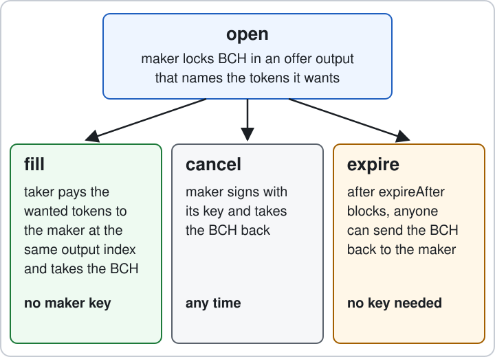
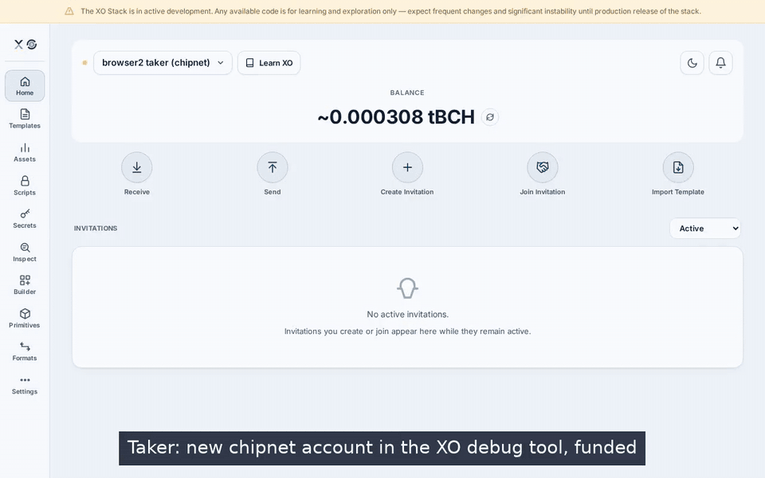

# Build with XO: Swap Intent

OTC offers of BCH for CashTokens without an online maker or escrow: whoever pays the wanted tokens fills the offer,
and expired offers return to the maker without a key.



New project. First commit after the 14 November start: [1ac2691](https://github.com/aimanmalib/sampan-xo/commit/1ac2691e4c699dcc3563fafcd2815bf6eadd6b94) (2026-11-14 17:40 UTC).

Submitted invitation: `invitations/browser2-fill.json`

That invitation is the fill of run `browser2`: the maker side was built by `@xo-cash/engine` 0.1.1-next.18170561234 in
this repository, the taker side was built and signed by a separate account inside the XO debug tool
(https://blaze.xo.cash/), and the final transaction was broadcast on chipnet. It names template version 2,
`8f0fb78d...712e`, stored as [template/used/8f0fb78d266c54d77852910b1ed8fb3772a1a7cd625dde6b548a247f9896712e.json](template/used/8f0fb78d266c54d77852910b1ed8fb3772a1a7cd625dde6b548a247f9896712e.json).
The earlier run `browser1` did the same with template version 1 and the older engine.

[](docs/debug-tool/swap-intent/taker-clip.mp4)

The taker side of run browser2 in the XO debug tool, cut to 33 seconds: join the maker's fill invitation as `Taker`,
give a receiving address, set up both outputs, add a token coin and a BCH coin, add change, sign its two inputs, copy the
invitation back to the maker; after the maker broadcast, "Update invitation" shows it completed and "Inspect" reports
`SUCCESS`. [MP4](docs/debug-tool/swap-intent/taker-clip.mp4) (no audio); the frames come from a fresh disposable chipnet
account, recorded after it was created and funded.

## What Swap Intent is

Swap Intent ([template/swap-intent.ts](template/swap-intent.ts), exported as
[template/swap-intent.json](template/swap-intent.json)) is an XO template for a one-sided CashTokens swap offer. The
`maker` starts with `open`: it locks some BCH and states the token category and amount it wants. A `taker` can then
`fill` the offer by paying that amount of tokens to the maker at the same output index, without any signature from
the maker. The maker can `cancel` with its key at any time. Since template version 2, anyone can `expire` an offer
that is at least `expireAfter` blocks old, which returns the BCH to the maker with no signature
([ADR 0003](docs/decisions/0003-swap-intent-expiry.md)).

## The four flows on chipnet

Every txid is an `ok` row in [docs/CHIPNET-RUNS.md](docs/CHIPNET-RUNS.md), which also lists the failed attempts.

| Flow | Action | Txid | Invitation | Template |
| --- | --- | --- | --- | --- |
| open -> fill (run3) | open | c96a928911e301a808859080fbd842004ab47e79992f63023110a5f3884388ce | [invitations/run3-open.json](invitations/run3-open.json) | [template/used/c4f2cf9439468e95f8a43852b2c874d336ebb082652467766ed4cf03275aa456.json](template/used/c4f2cf9439468e95f8a43852b2c874d336ebb082652467766ed4cf03275aa456.json) |
| | fill | f6d0359759159ac189383ea76155d2bc7dad63d153c67f95ca9162df6ab0a7a2 | [invitations/run3-fill.json](invitations/run3-fill.json) | same |
| open -> cancel (run2) | open | 66b0a6d5cb7b263e960bfa4ed9d9c8ec3952501dc4d7ae3f8a22edcaa2768d85 | [invitations/run2-open.json](invitations/run2-open.json) | same |
| | cancel | 8472ca5d982bff800fa471f0811b5c9a3af597c96b8dd0e73d555a7ed44de110 | [invitations/run2-cancel.json](invitations/run2-cancel.json) | same |
| open -> expire (run4) | open | d76f3c9f2a190dcddd8c0c28dae338d0fc5f69ecb48d0d1195faa2dc11ecf367 | [invitations/run4-open.json](invitations/run4-open.json) | [template/used/8f0fb78d266c54d77852910b1ed8fb3772a1a7cd625dde6b548a247f9896712e.json](template/used/8f0fb78d266c54d77852910b1ed8fb3772a1a7cd625dde6b548a247f9896712e.json) |
| | expire | 4d92f782949444f9751ce3dcbd685696319f474f129893fc617f5792f5b35f48 | [invitations/run4-expire.json](invitations/run4-expire.json) | same as run4 open |
| open -> fill on engine 0.1.1-next.18170561234 (run5) | open | 70e14b031f3571ac477fc2634b6517f60f6bcad5374b53daa4634c4141dc1545 | [invitations/run5-open.json](invitations/run5-open.json) | [template/used/8f0fb78d266c54d77852910b1ed8fb3772a1a7cd625dde6b548a247f9896712e.json](template/used/8f0fb78d266c54d77852910b1ed8fb3772a1a7cd625dde6b548a247f9896712e.json) |
| | fill | 565cc19f701d41f6dae8fe48b0a0de0ed7fae492b45c7610e47549d336ca8103 | [invitations/run5-fill.json](invitations/run5-fill.json) | same as run5 open |
| fill from the debug tool (browser1) | open | 7f3896aed87a94eb1b9dee9dd938f5c6567ad97766cca8a702af2a8e54151101 | [invitations/browser1-open.json](invitations/browser1-open.json) | [template/used/c4f2cf9439468e95f8a43852b2c874d336ebb082652467766ed4cf03275aa456.json](template/used/c4f2cf9439468e95f8a43852b2c874d336ebb082652467766ed4cf03275aa456.json) |
| | fill | f92159229f9ec6b3b55feeb43ffc48cd67e297075d259671c8d6d41a71c118a6 | [invitations/browser1-fill.json](invitations/browser1-fill.json) | same |
| fill from the debug tool, recorded (browser2) | open | 0b712fdf8958d3df4f6904dfb266f7d9c0919f906aca80b2850726551186d93e | [invitations/browser2-open.json](invitations/browser2-open.json) | [template/used/8f0fb78d266c54d77852910b1ed8fb3772a1a7cd625dde6b548a247f9896712e.json](template/used/8f0fb78d266c54d77852910b1ed8fb3772a1a7cd625dde6b548a247f9896712e.json) |
| | fill | c145510b5a1080e6e48755b7cd7bb08d6551cd6483c49d1b38832cb9b072c195 | [invitations/browser2-fill.json](invitations/browser2-fill.json) | same as browser2 open |

One minimum run on mainnet (`swapmain1`, 2000 sat, rows in [docs/MAINNET-SWAP-RUNS.md](docs/MAINNET-SWAP-RUNS.md)):

| Flow | Action | Txid | Invitation | Template |
| --- | --- | --- | --- | --- |
| open -> expire on mainnet (swapmain1) | open | 06e1273d217e3b2e4c4f009d1f33009f141116cc59e0abb9bb5d16f04d3ee6ba | [invitations/swapmain1-open.json](invitations/swapmain1-open.json) | [template/used/8f0fb78d266c54d77852910b1ed8fb3772a1a7cd625dde6b548a247f9896712e.json](template/used/8f0fb78d266c54d77852910b1ed8fb3772a1a7cd625dde6b548a247f9896712e.json) |
| | expire | 1a0ce51bcafda1328a2045aaadbdadb4d74486bd86672ad46e4161a767a2d511 | [invitations/swapmain1-expire.json](invitations/swapmain1-expire.json) | same as swapmain1 open |

The maker got 1500 sat back with no key; all mainnet fees of the run were 1085 sat. Mainnet explorer:
`https://blockchair.com/bitcoin-cash/transaction/<txid>`.

Explorers: `https://chipnet.imaginary.cash/tx/<txid>` or `https://explorer.selene.cash/tx/<txid>`.
run1 is an earlier open -> fill with the same template as run3. run1 to run4 and browser1 used `@xo-cash/engine`
0.1.1-next.18029697917; run5, run6 (open -> cancel) and browser2 used 0.1.1-next.18170561234, the `next` tag on
20 November. All runs are in the [README](README.md#runs-invitations-and-templates).

## Screenshots of the XO debug tool

[docs/debug-tool/swap-intent/](docs/debug-tool/swap-intent/) holds each saved Swap Intent invitation opened with
"View invitation", "Inspect" with status `SUCCESS` for each transaction, and each step of the browser1 and browser2 taker sides. The
index is [docs/debug-tool/README.md](docs/debug-tool/README.md).

## Check it yourself

Offline (Node.js 22, no network, no wallet):

```sh
npm ci
npm test
npx tsx scripts/used-templates.ts --check
npx tsx scripts/runs-table.ts --check
```

`used-templates --check` confirms that each invitation's template id is the sha256 the XO engine computes for the
stored file. In https://blaze.xo.cash/ (new chipnet account, no funds needed): "Import Template" with the
`template/used/<id>.json` the invitation names, then "Join Invitation" with the invitation file and "View invitation";
"Inspect" on `chipnet` with any txid above.

To repeat the runs on chipnet with your own test wallets, follow the README sections "Setup, step by step" and "Take an
offer from inside the XO debug tool". The short form:

```sh
npx tsx scripts/wallets.ts generate
npx tsx scripts/mint-test-token.ts fund
npx tsx scripts/mint-test-token.ts mint
npx tsx scripts/deposit.ts maker
npx tsx scripts/deposit.ts taker
npx tsx scripts/run.ts fill run1
npx tsx scripts/run.ts open run2
npx tsx scripts/run.ts cancel run2
npx tsx scripts/run.ts open run4
npx tsx scripts/run.ts expire run4
```

The last command refuses until the offer is `swap.expireAfterBlocks` blocks old (`config/chipnet.json`).

## Known limits

The covenant checks one output, so there are no partial fills. Through the XO engine only the maker's account tracks
the offer coin, so a fill is interactive (the maker adds the offer input) and the keyless expire is built by the
maker's account. Chipnet test wallets, plus the one minimum mainnet run above. The full list is in the [README](README.md#known-limits).
