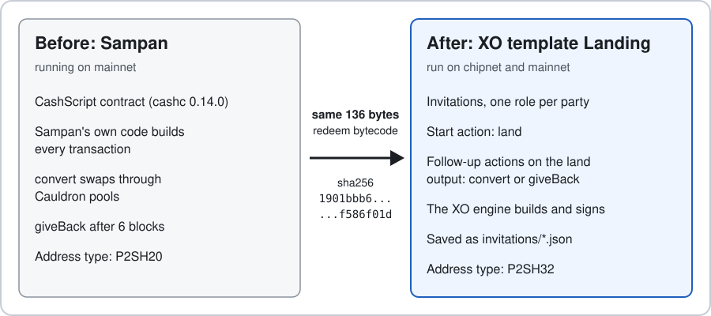

# Migrate to XO: the Sampan landing address as the XO template "Landing"

Sampan's landing address contract, live on BCH mainnet, is now the XO template Landing: the XO engine compiles the same
136-byte redeem bytecode as the deployed contract, and its actions ran through XO invitations (`land`, `convert` and
`giveBack` on chipnet, `land` then `giveBack` on mainnet).

New project: first commit after the 14 November start ([1ac2691](https://github.com/aimanmalib/sampan-xo/commit/1ac2691e4c699dcc3563fafcd2815bf6eadd6b94), 2026-11-14 17:40 UTC).

The landing address contract of Sampan, ported to an XO template with the start action `land` and the follow-up actions
`convert` and `giveBack`. The details and the runs are in the [README](README.md#migrate-to-xo).

## Before and after

<!-- before-after:start -->
| | Original (Sampan, CashScript) | XO template (this repo) |
| --- | --- | --- |
| Contract source | [contracts/landing.cash](https://github.com/aimanmalib/sampan/blob/main/contracts/landing.cash) | [template/landing.ts](template/landing.ts), exported as [template/landing.json](template/landing.json) |
| Compiler | cashc 0.14.0 (artifact: [tests/fixtures/landing-artifact.json](tests/fixtures/landing-artifact.json)) | XO template CashASM, compiled by `@xo-cash/engine` 0.1.1-next.18170561234 (`@xo-cash/templates` 0.0.12, `@xo-cash/types` 0.0.8); chipnet `landing6` ran on this version, the earlier runs on 0.1.1-next.18029697917 |
| sha256 of the redeem bytecode (136 bytes, parameters of the deployed contract) | `1901bbb619676836ffa58180113e57612d01e47caad8d8a1fb1aedbff586f01d` (from the deployed transaction) | `1901bbb619676836ffa58180113e57612d01e47caad8d8a1fb1aedbff586f01d` (compiled by the XO engine); `check-bytecode` prints `identical: true` |
| P2SH wrapper | P2SH20 address | P2SH32 address: XO's `p2sh` locking type is P2SH32 and there is no P2SH20 type ([ADR 0002](docs/decisions/0002-byte-identical-port.md)) |
| Who builds the transactions | Sampan's own code; for `convert` the other inputs and outputs are Cauldron pools | The XO engine, through invitations: one role per party, saved as `invitations/*.json` |
| Functions and actions | pay to the address from any wallet; functions `convert` and `giveBack` | start action `land`; follow-up actions `convert` and `giveBack` on the `land` output |
| Network proof | mainnet `giveBack` [5671fd920b3a3c74d322b23250d31a33326452e28528236227f0c89f3a585ba6](https://blockchair.com/bitcoin-cash/transaction/5671fd920b3a3c74d322b23250d31a33326452e28528236227f0c89f3a585ba6) | chipnet `landing3` `convert` [5c15f12c1e4fe868a5c0761c4592b019c07d71106e3faba99a00c8e240dfabe1](https://chipnet.imaginary.cash/tx/5c15f12c1e4fe868a5c0761c4592b019c07d71106e3faba99a00c8e240dfabe1), chipnet `landing4` `giveBack` [84db84e9a1bc8d6f959432eddb91d52b368ffd1872722cf87723e717c273164d](https://chipnet.imaginary.cash/tx/84db84e9a1bc8d6f959432eddb91d52b368ffd1872722cf87723e717c273164d), mainnet `mainnet1` `land` [7307ceebe247f57b177f8dbcb69cad97a3a05055712d74934b65f0713551b8ef](https://blockchair.com/bitcoin-cash/transaction/7307ceebe247f57b177f8dbcb69cad97a3a05055712d74934b65f0713551b8ef), mainnet `mainnet1` `giveBack` [80387030d47911bb9fa144892cf853a61cb3e4e8bc5f3ce948e78e99e67ca8d8](https://blockchair.com/bitcoin-cash/transaction/80387030d47911bb9fa144892cf853a61cb3e4e8bc5f3ce948e78e99e67ca8d8) |
<!-- before-after:end -->

Check it offline: `npx tsx scripts/check-bytecode.ts --json`. It verifies the raw deployed transaction in
[tests/fixtures/landing-deployed.json](tests/fixtures/landing-deployed.json), then compares the deployed redeem bytecode,
the one the XO engine compiles from the template, and the one cashc's artifact gives for the same parameters.

The mainnet run `mainnet1` (land, then giveBack) seen in the XO debug tool, "Inspect" status SUCCESS on `mainnet`:
[docs/debug-tool/](docs/debug-tool/README.md#landing-mainnet-mainnet1).
