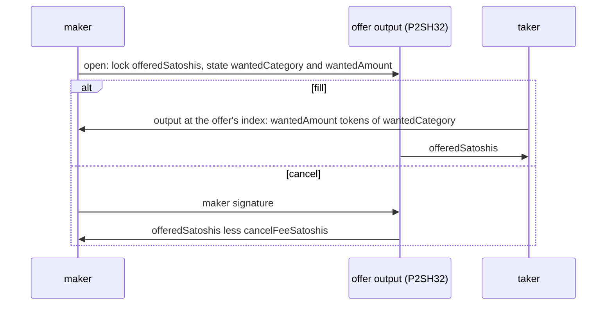
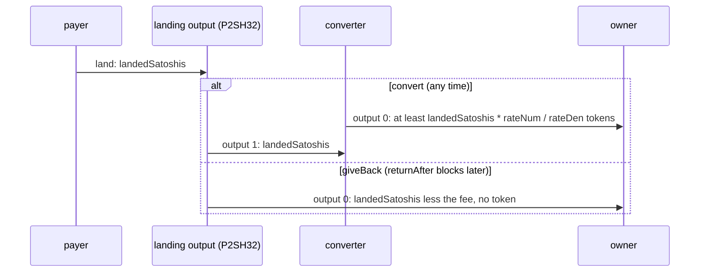

# Swap Intent: an XO template for CashTokens swaps on chipnet

An entry for the "Build with XO" bounty at BCH BLAZE 2026. The same repository also holds the "Migrate to XO" entry:
the Sampan landing contract as an XO template, see [Migrate to XO](#migrate-to-xo).

Build journal, written by the AI coding agent while it worked. The feedback in FEEDBACK.md was written by the entrant, by hand.

## What it is

Swap Intent is an XO template with two roles:

- `maker` opens an offer: locks some BCH and states which CashToken category and how many tokens they want for it.
- `taker` fills the offer: pays the wanted tokens to the maker and takes the BCH.
- `maker` can cancel an open offer and take the BCH back.

The offer is enforced by the locking script, not by either party: a fill is valid only if the output at the same index as the
offer input pays the maker's locking bytecode, carries the wanted token category, and carries at least the wanted token amount.

Status: the template, the offline tests and both chipnet flows (open -> fill and open -> cancel) are done. The
[build journal](JOURNAL.md) records each step with timestamps.



Template variables:

| Variable | Set by | Meaning |
| --- | --- | --- |
| `offeredSatoshis` | maker on `open` | BCH locked in the offer; the taker receives all of it on fill |
| `wantedCategory` | maker on `open` | CashToken category the maker wants, in explorer byte order |
| `wantedAmount` | maker on `open` | minimum fungible token amount the maker wants |
| `makerLockingScript` | maker on `open` | where the tokens (on fill) or the refund (on cancel) go |
| `makerKey` | generated on `open` | key whose signature is the only way to cancel |
| `takerLockingScript` | taker on `fill` | where the taker receives the offered satoshis |

The template source is [template/swap-intent.ts](template/swap-intent.ts); the same template as JSON for import into
XO tools is [template/swap-intent.json](template/swap-intent.json).

## Requirements

- Node.js 22 (see `.nvmrc`) and npm.
- Package versions are pinned exactly in `package.json` and `package-lock.json`. The ones that matter:
  `@xo-cash/engine` 0.1.1-next.18029697917, `@xo-cash/templates` 0.0.12, `@xo-cash/types` 0.0.8,
  `@xo-cash/utils` 0.0.10, `@bitauth/libauth` 3.1.0-next.8, `@electrum-cash/network` 4.4.8, `typescript` 5.9.3,
  `tsx` 4.23.15, `vitest` 3.2.7.
- Chipnet only. Nothing in this repository targets mainnet.

## Setup, step by step

1. Install and run the offline checks (typecheck and unit tests, no network):

   ```sh
   npm ci
   npm test
   ```

2. Create two chipnet test wallets. This writes `.env` (mode 0600; the variable names are in `.env.example`) with a
   maker and a taker phrase and prints the two funding addresses only. Never put a mainnet phrase there.

   ```sh
   npx tsx scripts/wallets.ts generate
   ```

3. Get chipnet coins for the maker address from a public chipnet faucet such as https://chipnet.bch.ninja/ or
   https://tbch.googol.cash/ (100,000 satoshis is enough), then check:

   ```sh
   npx tsx scripts/wallets.ts balance
   ```

4. Send the taker coins for fees and create a fungible test token for it (outside XO, with libauth). After `mint`,
   put the printed category into `testToken.category` in `config/chipnet.json`.

   ```sh
   npx tsx scripts/mint-test-token.ts fund
   npx tsx scripts/mint-test-token.ts mint
   ```

5. Move each account's coins (and the taker's test tokens) into its XO engine wallet:

   ```sh
   npx tsx scripts/deposit.ts maker
   npx tsx scripts/deposit.ts taker
   ```

6. Run open -> fill, then a second offer with open -> cancel (next section):

   ```sh
   npx tsx scripts/run.ts fill run1
   npx tsx scripts/run.ts open run2
   npx tsx scripts/run.ts cancel run2
   ```

The token, deposit and run commands accept `--dry-run` (build and check without broadcasting), and
`npx tsx scripts/run.ts --help` prints the run steps. Settings that may change (Electrum servers, derivation path,
explorers, amounts) live in `config/chipnet.json`. Every chipnet transaction is listed in
[docs/CHIPNET-RUNS.md](docs/CHIPNET-RUNS.md).

## Chipnet runs

`scripts/run.ts` drives `@xo-cash/engine` for each account (engine databases under `.xo/`, ignored by git). Each step is
its own process and the accounts exchange only invitation files:

1. `open` (maker): locks `swap.offeredSatoshis` in the offer and states the wanted token and amount.
2. `fill-start` (maker): starts the `fill` invitation with the offer coin at input 0. Only the maker's engine tracks the
   offer coin and holds the key whose public key is in the redeem script, so the maker supplies that input.
3. `fill-take` (taker): joins as `taker`, adds the token payment to the maker at output 0, the payout to itself, its own
   coins and change, and signs its inputs.
4. `fill-finish` (maker): adds the offer input's unlocking bytecode and broadcasts.

`npx tsx scripts/run.ts fill <run>` runs the four steps in order, each in its own process. To withdraw an open offer
instead, `npx tsx scripts/run.ts cancel <run>` (maker, same engine as `open`) spends the offer back to the maker's
locking script, less the template's `cancelFeeSatoshis`.

Every step accepts `--dry-run` (build and check without broadcasting). The chipnet transactions:

| Run | Action | Txid |
| --- | --- | --- |
| run1 | open | [74fb6c7b...3b99](https://chipnet.imaginary.cash/tx/74fb6c7b5299ec2be0e0b4832ab4c4bd6837f8904505fe0905b932c0c77c3b99) |
| run1 | fill | [326ee1c1...6862](https://chipnet.imaginary.cash/tx/326ee1c18edae7a42317c062237028150145d6f8e8cd5579baa3653e094d6862) |
| run2 | open | [66b0a6d5...8d85](https://chipnet.imaginary.cash/tx/66b0a6d5cb7b263e960bfa4ed9d9c8ec3952501dc4d7ae3f8a22edcaa2768d85) |
| run2 | cancel | [8472ca5d...e110](https://chipnet.imaginary.cash/tx/8472ca5d982bff800fa471f0811b5c9a3af597c96b8dd0e73d555a7ed44de110) |
| run3 | open | [c96a9289...88ce](https://chipnet.imaginary.cash/tx/c96a928911e301a808859080fbd842004ab47e79992f63023110a5f3884388ce) |
| run3 | fill | [f6d03597...a7a2](https://chipnet.imaginary.cash/tx/f6d0359759159ac189383ea76155d2bc7dad63d153c67f95ca9162df6ab0a7a2) |
| browser1 | open | [7f3896ae...1101](https://chipnet.imaginary.cash/tx/7f3896aed87a94eb1b9dee9dd938f5c6567ad97766cca8a702af2a8e54151101) |
| browser1 | fill | [f9215922...18a6](https://chipnet.imaginary.cash/tx/f92159229f9ec6b3b55feeb43ffc48cd67e297075d259671c8d6d41a71c118a6) |

The saved invitations are in [invitations/](invitations/); the full list, failures included, is in
[docs/CHIPNET-RUNS.md](docs/CHIPNET-RUNS.md).

## Open a saved invitation in the XO debug tool

The XO debugging wallet at https://blaze.xo.cash/ reads the saved invitations and the chipnet transactions. Use a new
disposable account there; no funds are needed to view.

1. Open https://blaze.xo.cash/, choose "Create new account", set the network to `chipnet`, then "Save and use account".
2. "Import Template", paste the contents of [template/swap-intent.json](template/swap-intent.json) and choose
   "Import JSON". The tool reports `Template imported: Swap Intent (c4f2cf94...a456)`. Regenerate the file with
   `npx tsx scripts/export-template.ts` after changing `template/swap-intent.ts`.
3. "Join Invitation", paste a file from [invitations/](invitations/) (for example `run2-cancel.json`) and choose
   "View invitation". The tool lists the action, each commit with its role, and the broadcast result. Choose "Cancel"
   to leave without accepting.
4. "Inspect", choose `chipnet` and paste a txid from the table above. The script debugger steps through each input;
   the offer input shows the redeem script with the fill and cancel branches.

## Take an offer from inside the XO debug tool

In run `browser1` the taker was a new disposable chipnet account in https://blaze.xo.cash/, which built, signed and
exported its part of the fill. To do the same:

1. In the debug tool create a chipnet account and import `template/swap-intent.json` (steps 1 and 2 above). "Receive"
   asks for a default receive policy: choose "Set up default receive", then `Receive` and `Wallet (P2PKH)`. Do the same
   for `Change` under Settings, Defaults, or the tool cannot add change later. "Receive" then shows the address.
2. Fund that address from the maker's engine wallet:

   ```sh
   npx tsx scripts/send.ts maker <bchtest:address> tokens 1000 <run>
   npx tsx scripts/send.ts maker <bchtest:address> sats 30000 <run>
   ```

3. Open the offer and start the fill: `npx tsx scripts/run.ts open <run>`, then `npx tsx scripts/run.ts fill-start <run>`.
4. In the debug tool: "Join Invitation", paste `invitations/<run>-fill-start.json`, "View invitation", choose the role
   `Taker`, "Accept invitation", "Add to invitation". On the invitation page paste the account's address as
   `takerLockingScript` and "Add"; "Set up output" for both outputs with role `taker`; "Add input", "Select all";
   "Add change", "Add selected change"; then "Sign", "Generate selected", "Append to invitation". Every change asks
   for a confirmation ("Add to invitation").
5. "Copy invitation" and save the JSON as `invitations/<run>-fill-taken.json`, then
   `npx tsx scripts/run.ts fill-finish <run>` completes the offer input and broadcasts. "Update invitation" with
   `invitations/<run>-fill.json` shows the invitation as completed in the tool.

## Known limits

- The covenant checks only the output at the same index as the offer input. One offer is filled as a whole; there are
  no partial fills.
- The fill path needs no signature, so anyone who sees an open offer can fill it; the first valid transaction wins.
- Offers do not expire. An offer stays open until it is filled or the maker cancels it.
- Through the XO engine in this repository, a fill is interactive: only the maker's engine tracks the offer coin, so the
  maker adds the offer input (`fill-start`) and its unlocking bytecode (`fill-finish`) around the taker's step.
- The cancel fee is a fixed template constant (`cancelFeeSatoshis`, 500 satoshis).
- `Engine.stop()` did not always settle during the chipnet runs, so the scripts wait at most
  `swap.engineStopTimeoutSeconds` for it and then exit.
- Chipnet test wallets only. The code has not been reviewed for use with real funds.

## Migrate to XO

A second entry in this repository, for the "Migrate to XO" bounty at BCH BLAZE 2026: the landing address contract of
Sampan, ported to an XO template named "Landing" and run on chipnet with two follow-up actions.

- Original project: https://sampan.sasateguh.com, source https://github.com/aimanmalib/sampan, contract
  `contracts/landing.cash` (CashScript, P2SH20). Sampan runs it on mainnet; nothing here touches that deployment.
- XO implementation: [template/landing.ts](template/landing.ts), exported for XO tools as
  [template/landing.json](template/landing.json); run script [scripts/landing-run.ts](scripts/landing-run.ts); saved
  invitations `invitations/landing*.json`; design record [docs/decisions/0001-migrate-landing.md](docs/decisions/0001-migrate-landing.md).

The original contract: anyone pays BCH to the landing address, and the coin can then leave only to the owner, either
converted to tokens at or above a minimum rate (`convert`) or returned as BCH once it is a few blocks old (`giveBack`).
No key of the service is needed for either path. The XO template keeps those rules in its locking script.

| Original (`contracts/landing.cash`) | XO template "Landing" |
| --- | --- |
| pay BCH to the contract address from any wallet | start action `land`, role `payer` |
| function `convert` | follow-up action `convert` on the landing output, role `converter` adds the token input |
| function `giveBack` | follow-up action `giveBack` on the landing output; no key, the runs use the payer |
| constructor `ownerLock` | variable `ownerLockingScript` |
| constructor `tokenCategory` | variable `tokenCategory` (explorer byte order, reversed inside the script) |
| constructor `rateNum`, `rateDen` | variables `rateNum`, `rateDen` |
| constructor `returnAfter` | variable `returnAfter`, carried as the sequence number of the `giveBack` input |

The rules enforced by the landing locking script, as in the original:

- `convert`: the landing coin is input 0, there are as many outputs as inputs, output 0 pays `ownerLockingScript` and
  carries fungible tokens of `tokenCategory`, and `tokenAmount * rateDen >= landedValue * rateNum`.
- `giveBack`: the landing coin is input 0 and at least `returnAfter` blocks old (`OP_CHECKSEQUENCEVERIFY`), one input and
  one output, output 0 pays `ownerLockingScript` with no token and at least the landed value less 1000 satoshis.



### Differences from the original

- **P2SH32 instead of P2SH20.** The template uses the XO `p2sh` locking type, which is P2SH32, so the landing address
  differs from the one Sampan computes for the same parameters. The rules are the same.
- **A `converter` role instead of a Cauldron pool.** Chipnet has no Sampan token and no pool for it. The fungible test
  token minted for the Swap Intent runs (`testToken.category` in `config/chipnet.json`) stands in, and the `taker`
  account, which holds it, adds the token input and receives the landed BCH. The contract never checked who provides the
  other inputs, so this changes the counterparty, not the rules.
- **The output count is fixed by the template.** The converter states its token coin's satoshis and tokens and the fee
  as variables, so `convert` has two inputs and two outputs and the engine adds no change output.
- The values used on chipnet live in `config/chipnet.json` under `landing`: 10000 landed satoshis, rate 1/100 (100 test
  token units for 10000 satoshis), `returnAfter` 6 as in Sampan, a 500 satoshi giveBack fee.

### Chipnet runs (Landing)

| Run | Action | Txid |
| --- | --- | --- |
| landing1 | land | [78832800...a894](https://chipnet.imaginary.cash/tx/7883280023308e712beb1a51f5f9ba050dd740b7a8099fcf14e18a98437ca894) |
| landing1 | convert | [7a9b82e8...d056](https://chipnet.imaginary.cash/tx/7a9b82e8159b01bcf53e5c556f90d568a32961a4aef7551d119454bc7461d056) |
| landing2 | land | [a0e6da27...ce47](https://chipnet.imaginary.cash/tx/a0e6da274c8c5881bfc5c0c103c4d64f1612d1d69b79aeac876fea165ffdce47) |
| landing2 | giveBack | [de837976...19dd](https://chipnet.imaginary.cash/tx/de83797632b64d4725fcd47ec9325fc49dc36cddf30fdd7d301137d01d1819dd) |

All four ran through the XO engine. In landing1 the owner received 100 test token units at output 0 of the convert
transaction. In landing2 the owner received 9500 satoshis with no token. The first giveBack attempts were refused by
the chipnet nodes as `non-BIP68-final` until about an hour after the land coin was mined; the refusals are rows in
[docs/CHIPNET-RUNS.md](docs/CHIPNET-RUNS.md) and the measurements are in the [journal](JOURNAL.md).

### Reproduce the invitations

After steps 1 to 5 of the setup above (wallets, chipnet coins for the maker, test token and deposits):

1. Add the owner account. This appends `OWNER_MNEMONIC` to `.env` and refuses to replace a phrase that is already set.
   Put the printed token-aware owner address into `landing.ownerAddress` in `config/chipnet.json`.

   ```sh
   npx tsx scripts/wallets.ts add
   npx tsx scripts/wallets.ts addresses
   ```

2. Land and convert (the three convert steps run as separate processes, payer and converter exchange invitation files):

   ```sh
   npx tsx scripts/landing-run.ts land landing1
   npx tsx scripts/landing-run.ts convert landing1
   ```

3. Land a second coin, wait until it is `landing.returnAfter` blocks old, then return it to the owner. The giveBack
   step reads the coin's age from chipnet Electrum first and refuses a coin that is too young.

   ```sh
   npx tsx scripts/landing-run.ts land landing2
   npx tsx scripts/landing-run.ts giveBack landing2
   ```

Each step writes `invitations/<run>-<step>.json` and accepts `--dry-run`; `npx tsx scripts/landing-run.ts --help`
prints the steps. The offline tests for the template (convert and giveBack paths, each covenant check failing on its
own) are `tests/landing-*.test.ts` and run with `npm test`.

### Open the Landing invitations in the XO debug tool

Follow "Open a saved invitation in the XO debug tool" above with the Landing files:

1. "Import Template" with the contents of [template/landing.json](template/landing.json). The tool reports
   `Template imported: Landing (03fad653...3515)`, "2 roles · 3 actions · 18 scripts". Regenerate the file with
   `npx tsx scripts/export-template.ts` after changing `template/landing.ts`.
2. "Join Invitation" with any `invitations/landing*.json`, then "View invitation". `landing1-convert.json` shows the
   `convert` action with its six commits and the broadcast result; `landing2-giveBack.json` shows `giveBack`.
3. "Inspect" on `chipnet` with the convert or giveBack txid above steps through the landing input and decodes its
   P2SH32 redeem script with both branches.

### Known limits (Landing)

- The engine does not wait for the relative lock and does not check a coin's age before it broadcasts; the run script
  does that check, and a node may still refuse the transaction for a while after it passes (see the journal).
- A broadcast that fails keeps the coin reserved by its invitation in the engine; the invitation has to be archived
  before the step can run again.
- Each `convert` or `giveBack` spends one landed coin, at input 0, as in the original.
- Chipnet test wallets and a test token only. The code has not been reviewed for use with real funds.

## AI disclosure

The code, tests, README and build journal in this repository were written by an AI coding agent working for the entrant,
with the entrant reviewing the result. The feedback in FEEDBACK.md was written by the entrant, by hand, without AI.

## Related

The entrant's main BCH BLAZE 2026 project is Sampan: https://sampan.sasateguh.com and https://github.com/aimanmalib/sampan

## License

MIT, see [LICENSE](LICENSE).
